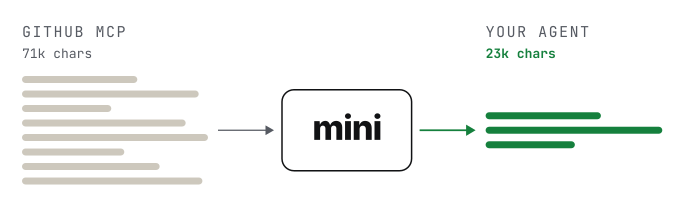
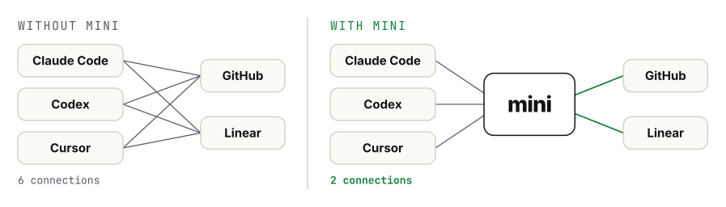

# mini

**mini** sits between your agent and its [MCP](https://modelcontextprotocol.io) servers. It drops fields the agent doesn't need and shortens long text, so responses cost fewer tokens.

<picture>
  <source media="(prefers-color-scheme: dark)" srcset="docs/images/call-flow-dark.svg">
  
</picture>

<sub>Listing 10 open issues on golang/go.</sub>

**Before:** one pull request from a `list_pull_requests` page:

```jsonc
{
  "number": 83077,
  "title": "cmd/compile: avoid copying byte slices in read-only string ranges",
  "body": "Reuse a byte slice's backing storage…", // 3.9k chars
  "user": {
    "login": "gopher",
    "profile_url": "https://github.com/gopher",
    "avatar_url": "https://avatars.githubusercontent.com/u/1234567?v=4"
  }
}
```

**After:** what the agent gets through mini:

```jsonc
{
  "number": 83077,
  "title": "cmd/compile: avoid copying byte slices in read-only string ranges",
  "body": "Reuse a byte slice's backing storage…", // cut to ~2k chars
  "user": {
    "login": "gopher",
    "profile_url": "https://github.com/gopher"
    // avatar_url removed: agents don't need images
  }
}
```

Agents can recover trimmed data via mini's `read` MCP tool. Responses are temporarily stored to avoid repeating requests.

## Install

```bash
go install github.com/mcpmini/mini/cmd/mini@latest
```

## Connect to your agents

### Quick setup: mini init

```bash
mini init
```

`mini init` walks you through setup:

- Imports the MCP servers your agents already use
- Lets you add more from the MCP catalog
- Logs you in to servers that need it
- Connects mini to your agents

### Manual setup

Register `mini connect` as an MCP server:

```bash
claude mcp add -s user mini -- mini connect   # Claude Code
codex mcp add mini -- mini connect            # Codex
```

Any other client takes the same command in its MCP config:

```json
{
  "mcpServers": {
    "mini": { "command": "mini", "args": ["connect"] }
  }
}
```

Your agent sees each upstream tool under the `mini` server, named like `github__list_pull_requests`.

## Add a server and make your first call

### Example: GitHub MCP

```bash
# Export a token first:
export GITHUB_TOKEN=...

# Add the server
mini add github \
  --url https://api.githubcopilot.com/mcp \
  --header "Authorization=Bearer $GITHUB_TOKEN"

# Check it connected
mini status

# Try a call
mini call github list_pull_requests '{"owner":"golang","repo":"go","perPage":5}'
```

mini recognizes GitHub's URL and installs its bundled projections. Every tool is visible; your MCP client's approval settings control writes.

### Other servers

```bash
mini add linear --url https://mcp.linear.app/mcp   # OAuth: mini add opens the login
mini add sentry --url https://mcp.sentry.dev/mcp
mini add slack  --url https://mcp.slack.com/mcp
mini add atlassian --url https://mcp.atlassian.com/v2/mcp
```

To skip the `mini init` questions, use `mini init --import` (every agent found), `mini init --from cursor` (one agent or config file), or `mini init --add linear,sentry` (catalog servers). These leave logins and agent configs alone and print what's left to do.

mini ships with default projections for popular tools including Slack, GitHub, Atlassian. You can see all [the bundled settings here](internal/defaults/projections/).

## How it works

mini runs on your machine. When your agent calls a tool, mini forwards the call to the server that owns it, trims the response with that tool's projection, and returns the result.

## One mini for all your agents

All your agent sessions share one mini, so each upstream server gets one connection instead of one per chat. `mini connect` starts the shared daemon when it isn't running. Check it with `mini daemon status`.

<picture>
  <source media="(prefers-color-scheme: dark)" srcset="docs/images/shared-mini-dark.svg">
  
</picture>

## Configuration

```
~/.mini/
  config.yaml              # global settings
  servers/<name>.yaml      # one file per upstream server
  internal/                # machine-managed runtime state
```

A server file:

```yaml
# ~/.mini/servers/github.yaml
transport: http
url: https://api.githubcopilot.com/mcp
auth:
  type: bearer
  token: "${GITHUB_TOKEN}"
projections:
  list_issues:
    string_limits:
      body: 1500     # cap each issue body at 1,500 chars
```

Edit the files in `~/.mini/servers/`; mini picks up changes without a restart. More in [docs/configuration.md](docs/configuration.md).

## Recovering filtered data

When mini cuts something, the result carries a `__mini` notice with a `file` key and the paths it cut. The full upstream result is saved on disk. The agent calls `read` with that `file` and a path to get back just what it needs. Details are in [docs/configuration.md](docs/configuration.md#recovering-filtered-data).

## Using mini from the CLI

`mini call` runs a tool without an agent. Use it in scripts and CI, to see what a tool returns before you write a projection, or from an agent that runs commands but has weak MCP support:

```bash
mini call github list_pull_requests '{"owner":"golang","repo":"go","perPage":3}'
mini call -t github list_issues '{"owner":"golang","repo":"go","state":"open","perPage":10}'
mini call -r github get_file_contents '{"owner":"golang","repo":"go","path":"README.md"}'
```

## Commands

```
mini connect [--standalone]               Connect an agent (stdio MCP)
mini daemon                               Run as a shared background daemon
mini daemon status                        Check whether the daemon is running

mini ls [SERVER [TOOL]]                   List servers and check connections, or a server's tools
mini add NAME (--url URL | -- CMD [ARGS...])  Add a server
mini rm NAME                              Remove a server
mini status                               Server health and tool counts
mini test [--timeout T]                   CI health check (exits 1 on any failure)
mini auth NAME                            OAuth2 PKCE flow for a server
mini init [--import | --from AGENT | --add NAMES]  Setup wizard
mini cleanup                              Delete expired response files

mini call [-j|-t|-r] SERVER TOOL [JSON]   Invoke a tool directly
```
